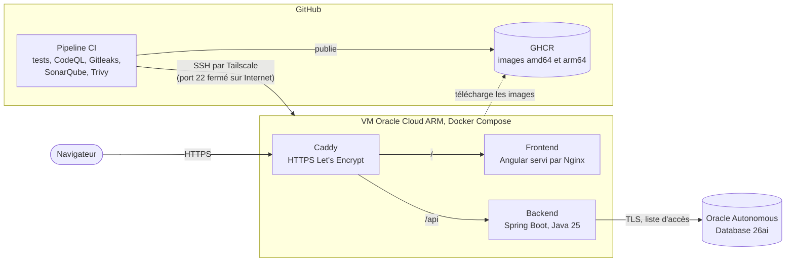

# ITSM Platform

[](https://github.com/SteveTetchoup26/itsm/actions/workflows/ci.yml)

Plateforme de gestion des incidents et des demandes informatiques (IT Service Management),
construite comme un projet d'entreprise : du besoin métier jusqu'à l'exploitation en production.

> Projet d'apprentissage en ingénierie logicielle. Entreprise et données fictives.

## Statut

| Incrément | Objectif | Statut |
|---|---|---|
| I0 | Walking skeleton : pipeline et déploiement continus | En cours : tout est prêt, en attente de la VM |
| I1 | Déclarer et consulter des tickets | À faire |
| I2 | Traiter les tickets de bout en bout | À faire |
| I3 | Piloter et administrer (fin du MVP) | À faire |
| I4 | Événements et notifications | À faire |
| I5 | Observabilité complète | À faire |
| I6 | Kubernetes et infrastructure en code | À faire |
| I7 | Résilience et sécurité avancée | À faire |
| I8 | Exploitation et simulations d'incidents | À faire |

## Stack

Angular · Java 25 · Spring Boot · Oracle Database · Keycloak · Kafka · Docker · Kubernetes (k3s) ·
GitHub Actions · OpenTelemetry · Grafana · Oracle Cloud (Always Free)

## Architecture



- **Une fusion dans `main` = une mise en production** : tests, analyses de sécurité, images
  multi-architecture, déploiement, tests de fumée, retour arrière automatique en cas d'échec
  ([pipeline](docs/pipeline-ci.md)).
- **Aucun port d'administration exposé** : le pipeline joint la VM par un réseau privé
  Tailscale, authentifié par OIDC, sans secret stocké ([ADR-012](docs/adr/0012-deploiement-tailscale.md)).
- **Base gérée** : Autonomous Database en TLS avec liste d'accès ([ADR-017](docs/adr/0017-connexion-tls-autonomous-database.md)),
  comptes séparés pour le schéma et l'application ([ADR-005](docs/adr/0005-migrations-flyway.md)).

## Documentation

| Document | Contenu |
|---|---|
| [Cahier des charges fonctionnel](docs/01-cahier-des-charges-fonctionnel.docx) | Besoin métier, règles de gestion, user stories |
| [Cahier des charges technique](docs/02-cahier-des-charges-technique.docx) | Architecture, environnements, outils, conventions |
| [Décisions d'architecture (ADR)](docs/adr/README.md) | Chaque choix structurant et sa justification |
| [Mise en place](docs/00-mise-en-place.md) | Comptes, dépôt, poste de travail |
| [Pipeline CI](docs/pipeline-ci.md) | Jobs, protection de `main`, SonarQube Cloud, Dependabot |
| [Journal](docs/journal/README.md) | Rétrospectives d'incrément |

## Démarrage rapide

Prérequis : Docker (avec Compose), Java 25, Node 24. Détails : [mise en place](docs/00-mise-en-place.md).

```bash
git clone https://github.com/SteveTetchoup26/itsm.git && cd itsm

# 1. Base Oracle locale (première fois : remplacer les change-me du fichier .env)
cp deploy/compose/.env.example deploy/compose/.env
docker compose -f deploy/compose/docker-compose.yml up -d --wait

# 2. Backend (http://localhost:8080) : applique les migrations Flyway au démarrage
cd backend
set -a; source ../deploy/compose/.env; set +a
./mvnw spring-boot:run

# 3. Frontend (http://localhost:4200), dans un autre terminal : /api est relayé vers le backend
cd frontend
npm ci --ignore-scripts
npm start
```

La page d'accueil affiche la version de l'application et l'état de la base.

| Pour aller plus loin | |
|---|---|
| Tests du backend (unitaires et intégration Oracle) | `cd backend && ./mvnw verify` ([détails](backend/README.md)) |
| Tests et lint du frontend | `cd frontend && npm run lint && npm run test:ci` ([détails](frontend/README.md)) |
| Base locale | [deploy/compose](deploy/compose/README.md) |
| Production (VM, base, réseau privé) | [deploy/compose](deploy/compose/README.md), [deploy/adb](deploy/adb/README.md), [deploy/tailscale](deploy/tailscale/README.md), [VM](docs/runbooks/vm-oracle-cloud.md) |
